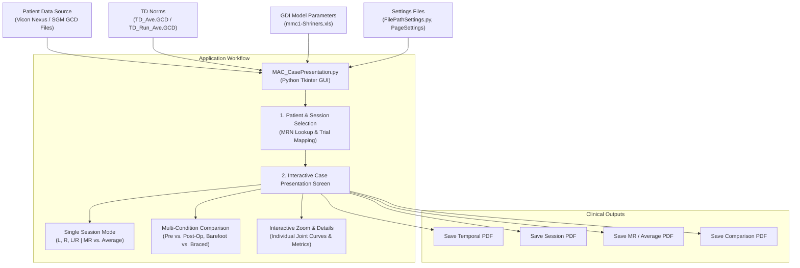

# Motion Analysis Center (MAC): Case Presentation System Guide

## 1. Overview & Purpose

The **MAC Case Presentation** application is a clinical gait analysis review and reporting platform developed for the **Motion Analysis Center (MAC)** at Shriners Hospitals for Children (Shriners Children's – Greenville, SC).

Its primary clinical function is to provide an interactive graphical interface and automated PDF reporting engine for multidisciplinary clinical teams (orthopedic surgeons, biomechanists, physical therapists, and physiatrists). During **Case Conferences** (clinical case presentations), the team uses this software to:
- Review 3D motion capture and kinematic/kinetic data of pediatric patients (e.g., cerebral palsy, idiopathic toe walking, limb length discrepancy).
- Inspect trial-to-trial repeatability and side-to-side gait asymmetry.
- Compare pre-operative vs. post-operative outcomes or barefoot vs. orthotic (AFO) conditions.
- Produce standardized clinical reports for patient medical records.

---

## 2. System Architecture & Data Flow



---

## 3. Underlying Data & Dependencies

| Component | Path / File | Purpose |
| :--- | :--- | :--- |
| **Main Application** | `MAC_CasePresentation.py` | Core Tkinter GUI, Matplotlib plotting canvas, and ReportLab PDF compiler. |
| **Path Configuration** | `FilePathSettings.py` | Sets institute name, session directory paths, normative files, and default view modes. |
| **Walking Norms** | `TD_Ave.GCD` | Normative reference corridor (Mean ± 1 SD) derived from typically developing (TD) children during walking. |
| **Running Norms** | `TD_Run_Ave.GCD` | Normative reference corridor (Mean ± 1 SD) for running trials. |
| **GDI Weights/Matrices** | `mmc1-Shriners.xls` | Reference feature parameters for calculating the Gait Deviation Index (GDI). |
| **Patient Settings Cache**| `DisplaySettingsLocation/` | Caches saved trial selections and folder associations per patient MRN. |
| **PDF Output Target** | `MAC PATIENT RECORDS/` | Default export directory for generated clinical PDF reports. |

### Gait Clinical Data (`.GCD`) Format
The application consumes `.GCD` text files output by gait analysis models (such as the Shriners Gait Model in Vicon Nexus). Each `.GCD` file contains:
- Header metadata (Patient ID, session date, leg length, body mass).
- Discrete spatio-temporal variables (cadence, velocity, stride time, step length, stance/swing phases).
- Continuous, time-normalized time series (101 points representing 0% to 100% of the gait cycle) for kinematics, joint moments, joint powers, EMG linear envelopes, and modeled muscle-tendon lengths.

---

## 4. Step-by-Step Clinical Workflow

### Step 1: Patient Lookup & Session Setup (`TrialSelection_Page`)
1. **Launch**: Start the tool using `MAC_CasePresentation.bat` or the desktop shortcut.
2. **Patient Lookup**: Enter the patient's **Medical Record Number (MRN)** and click **Select Patient**.
   - If the patient has been analyzed before, prior session folder paths and trial selections reload automatically from `DisplaySettingsLocation`.
3. **Session Linking**:
   - Click the folder icon (`...`) under **Dir** to link the patient's session folder.
   - Select the corresponding static calibration file (`.py`), which auto-fills the test date, study type, activity, and orthotic status.
4. **Trial Selection**:
   - Select up to **5 Left trials (L1–L5)** and **5 Right trials (R1–R5)** using the dropdown menus.
   - The same trial can be selected for both Left and Right if valid foot strikes exist for both sides.
   - Designate the default representative trial (defaults to L1 and R1).
5. **Multi-Session History**:
   - Click the add button to attach additional sessions (e.g., Session 1 = Baseline, Session 2 = 1-Year Post-Op).
6. **Code Version Verification**:
   - Click **Versions** to verify that all selected `.GCD` files were processed with an identical version of the Shriners Gait Model (SGM) pipeline.
7. **Proceed**: Click **Save & Proceed** to cache configurations and transition to the graphics engine.

---

### Step 2: Interactive Case Review (`GraphsDisplay_Page`)

The presentation dashboard is organized into three sections:

```
+------------------------------------+-----------------------------+------------------------------------+
|        LEFT PANEL (Session)        |        CENTER CANVAS        |      RIGHT PANEL (Comparisons)     |
+------------------------------------+-----------------------------+------------------------------------+
|  Select Session:                   |                             |  Select up to 3 conditions:        |
|  [Session 1 (e.g. Barefoot)]       |    Multi-panel Matplotlib   |  [x] Condition 1 (Baseline)        |
|                                    |       Gait Cycle Plots      |  [x] Condition 2 (Post-Op)         |
|  [MR <----Slider----> Ave]         |         (0 - 100%)          |  [x] Condition 3 (Braced)          |
|                                    |                             |                                    |
|  Graph Categories:                 |   - Patient Curves          |  [MR <----Slider----> Ave]         |
|   - Kinematics      [L] [R] [L/R]  |   - Normative Shaded Bands  |                                    |
|   - Sagittal Kin.   [L] [R] [L/R]  |   - Gait Cycle Events       |  Compare Across Conditions:        |
|   - Coronal Kin.    [L] [R] [L/R]  |                             |   - Kinematics         [L] [R]     |
|   - EMG             [L] [R] [L/R]  |  * Clicking any plot zooms  |   - Sagittal Kinetics  [L] [R]     |
|   - Foot Kin.       [L] [R] [L/R]  |    into full-screen detail  |   - Coronal Kinetics   [L] [R]     |
|   - Muscle Lengths  [L] [R] [L/R]  |                             |   - EMG                [L] [R]     |
|   - Stride/Temporal [Summary]      |                             |   - Foot Kinematics    [L] [R]     |
+------------------------------------+-----------------------------+------------------------------------+
                                                                   |  PDF Export Buttons:               |
                                                                   |  - Save Temporal PDF               |
                                                                   |  - Save Session PDF                |
                                                                   |  - Save MR PDF                     |
                                                                   |  - Save Comparison PDF             |
+------------------------------------+-----------------------------+------------------------------------+
```

#### 1. Single Session Inspection (Left Side)
- **L Button**: Overlays all selected Left-side trials (L1–L5) simultaneously to evaluate repeatability.
- **R Button**: Overlays all selected Right-side trials (R1–R5).
- **L/R Button**: Displays Left versus Right on the same axes to detect asymmetry.
- **MR vs. Ave Slider**:
  - **MR (Most Representative)**: Plots the single trial whose kinematic pattern is closest to the median GDI.
  - **Ave (Average)**: Plots the ensemble mean curve with ±1 standard deviation shaded corridor.

#### 2. Multi-Condition & Longitudinal Comparison (Right Side)
- Under **Conditions Comparison**, select up to 3 conditions (e.g., Pre-Op vs. Post-Op, Barefoot vs. AFO).
- Click **L** or **R** under any modality to plot the 3 conditions superimposed on the normative corridor.

#### 3. Interactive Detail Zoom
- Clicking on any subplot in the center canvas opens an enlarged, full-screen view of that specific joint angle, moment, or muscle parameter with numerical axis readouts.

---

## 5. Supported Clinical Modalities

| Modality | Settings File | Parameters & Channels Visualized |
| :--- | :--- | :--- |
| **Kinematics (3D Joint Angles)** | `KinematicsPageSettings.py` | **Trunk**: Tilt, Obliquity, Rotation.<br/>**Pelvis**: Tilt, Obliquity, Rotation.<br/>**Hip**: Flexion/Extension, Ab/Adduction, Internal/External Rotation.<br/>**Knee**: Flexion/Extension, Varus/Valgus, Internal/External Rotation.<br/>**Ankle/Foot**: Plantar/Dorsiflexion, Foot Progression, Foot Rotation. |
| **Sagittal Kinetics** | `SagittalKineticsPageSettings.py` | Hip, Knee, and Ankle Sagittal Moments (N·m/kg) and Joint Powers (W/kg; absorption & generation phases). |
| **Coronal Kinetics** | `CoronalKineticsPageSettings.py` | Hip and Knee Abduction/Adduction moments in the frontal plane. |
| **Foot Kinematics** | `FootKinematicsPageSettings.py` | Multi-segment foot motion: Hindfoot relative to Tibia, Forefoot relative to Hindfoot, Hallux motion. |
| **Dynamic EMG** | `EMGPageSettings.py` | Rectus Femoris, Hamstrings (Medial/Lateral), Tibialis Anterior, Gastrocnemius, Soleus envelopes against normative activation timing bars. |
| **Muscle-Tendon Dynamics**| `MuscleLengthPageSettings.py`<br/>`MuscleVelocityPageSettings.py` | Modeled muscle-tendon lengths (% of static reference) and shortening/lengthening velocities across the gait cycle. |
| **Spatio-Temporal Summary**| Computed from `.GCD` | Walking speed, cadence, stride length, step length, step width, % stance phase, % swing phase, single/double support duration. |
| **Gait Deviation Index (GDI)** | `mmc1-Shriners.xls` | Single scalar score of overall gait deviation (TD Mean = 100, SD = 10; scores below 100 quantify distance from typical gait). |

---

## 6. Clinical PDF Report Generation

Built with the `reportlab` library, the four PDF generators provide standardized outputs ready for electronic health records:

1. **Save Temporal PDF**:
   - Tabular summary of all spatio-temporal and stride parameters across left and right sides.
2. **Save Session PDF**:
   - Full clinical gait packet containing all selected trials for that session across all active modalities.
3. **Save MR PDF**:
   - Condensed summary report presenting only the Most Representative (MR) trial or the ensemble Average curve.
4. **Save Comparison PDF**:
   - Multi-condition comparison report comparing the selected conditions side-by-side.

---

## 7. Configuration & Troubleshooting

### Site Setup (`FilePathSettings.py`)
Ensure paths in `FilePathSettings.py` use forward slashes (`/`):
```python
InstituteName = "Motion Analysis Center, Shriners Children's - Greenville, SC"
ViconFilesLocation = "./"
DisplaySettingsFileLocation = Path(__file__).parent / "DisplaySettingsLocation"
GDIFeaturesFileName = Path(__file__).parent / "mmc1-Shriners.xls"
InitialPathForPdf = Path(__file__).parent / "MAC PATIENT RECORDS"
NormAveGCDFileName = Path(__file__).parent / "TD_Ave.GCD"
NormRunAveGCDFileName = Path(__file__).parent / "TD_Run_Ave.GCD"
MRorAve = "MR"
```

### Common Issues & Solutions
- **Dropdown List Missing Recent GCD**: Click **Save & Proceed**, then click **Back**. This refreshes the session directory contents.
- **Plots Do Not Render**: Check the console log. If a `.GCD` file is zero bytes (empty), re-export or re-process that trial in Vicon Nexus.
- **Weak or Low EMG Signals**: Wireless EMG systems may record low amplitude signals. Run `Py3_GCD_AmplifyEMG.py` through the pipeline to scale EMG envelopes before plotting.
