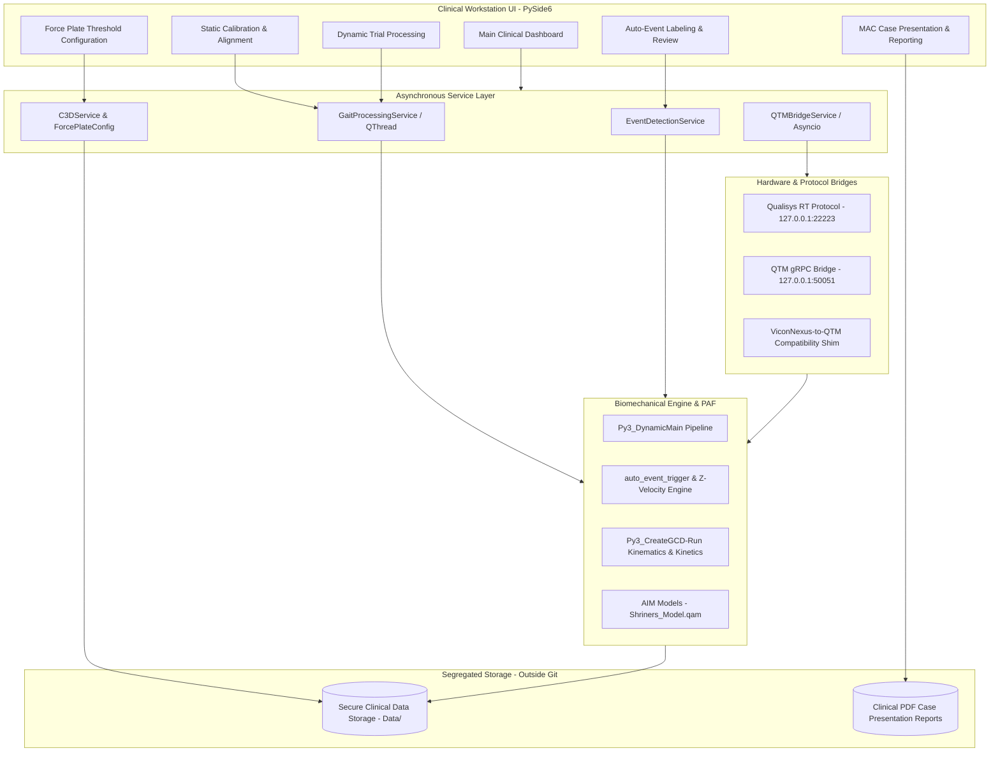

# System Architecture — Shriners Gait Analysis Platform

## 1. Executive Overview

The **Shriners Gait Analysis Platform** is a specialized, hospital-grade clinical motion analysis workstation. It bridges Qualisys Track Manager (QTM) optical motion capture systems, biomechanical kinematics/kinetics pipelines, and automated gait event detection with a high-performance clinical presentation and reporting interface.

---

## 2. Component Breakdown

### A. Frontend Desktop Interface (`app/ui/`)
- **Technology**: PySide6 (Qt for Python).
- **Core Windows & Pages**:
  - `MainWindow`: Application shell hosting sidebar navigation, status bars, and global theme toggling (Light / Dark mode).
  - `DashboardPage`: Overview of recent sessions, patient records, and hardware connection state.
  - `StaticProcessingPage`: Pre-processing, static calibration, subject anthropometrics, and leg alignment.
  - `DynamicProcessingPage`: Multi-trial dynamic gait pipeline execution, kinematic angle computation, and force plate assignment.
  - `AutoEventLabelingDialog`: Interactive review of detected Foot Strike (FS) and Foot Off (FO) events across gait cycles.
  - `ForcePlateConfigDialog`: 3D platform assignment, threshold tuning, and ground reaction force alignment.
  - `MAC_CasePresentation`: Case presentation tool generating longitudinal gait comparison graphs and standardized clinical reports.

### B. Core Service Layer (`app/services/`)
- **`GaitProcessingService`**: Asynchronous worker thread orchestrating long-running Python biomechanical pipelines without blocking the Qt event loop.
- **`QTMBridgeService`**: Real-time communication bridge communicating with QTM via both gRPC and Qualisys RT Protocol.
- **`EventDetectionService`**: Algorithmic detection of gait cycle events using foot marker trajectories, velocity thresholds, and force plate ground reaction signals.
- **`C3DService`**: High-performance parser extracting 3D marker coordinates, analog channels, and force plate calibration matrices from C3D binary files.

### C. Biomechanical Analysis Engine (`Gait-lab-Vicon-to-QTM/`)
- **`Py3_DynamicMain.py`**: Batch processor coordinating kinematic marker models, coordinate system definitions, and kinetic calculations.
- **`auto_event_trigger.py`**: Automatic event labeling identifying heel strike and toe-off transitions.
- **`Py3_CreateGCD-Run.py`**: Generation of Gait Clinical Data (GCD) files containing normalized 0–100% gait cycle waveforms.
- **`Py3_GCD_AmplifyEMG-AllChannels.py`**: Surface electromyography (EMG) channel amplification, filtering, and normalization.

### D. PAF & AIM Integration (`Shriners_Gait_Model_PAF_v1.0/`)
- Integration with Qualisys Project Automation Framework (PAF).
- Automated Identification of Markers (AIM) model definitions (`AIM models/Shriners_Model.qam`).
- Project configuration schemas (`Settings.paf`).

---

## 3. Data Flow & Security Boundaries

1. **Patient Data Boundary**: All raw trial files (`.qtm`, `.c3d`, `.avi`, `.GCD`) reside strictly in segregated storage designated by the `PATIENTS_DATA_LOCATION` configuration.
2. **Local Hardware Communication**: QTM RT and gRPC communication occurs over secure local loopback (`127.0.0.1`) and never broadcasts across untrusted public interfaces.
3. **Report Generation**: Clinical PDFs and graphs are exported directly to local clinical storage or institutional secure file shares.
